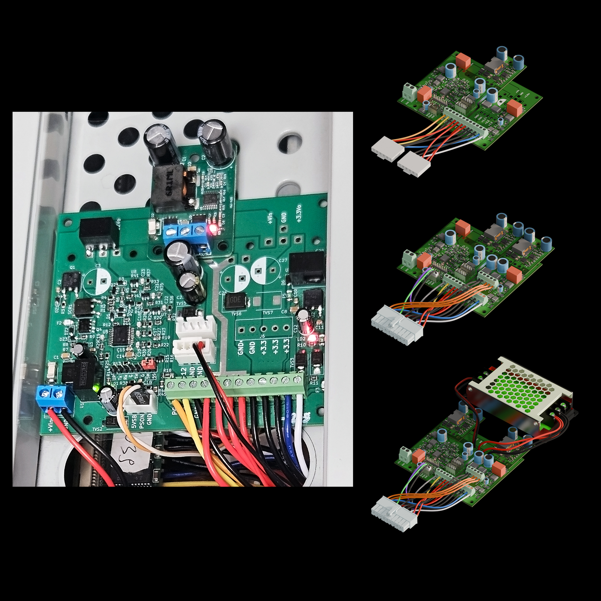

# atxanything
AT(X)Anything: a modular DC-DC PSU for old PCs

A modular DC-DC PC PSU power distribution/supervisor board
for custom power supplies for old computers. Make AT(X) PSU from anything, for anything, and make it safe. "Bring Your Own Converters" and put them on wires, or use PCB-mounted ones.

Placeholder project for now, details are here: https://hackaday.io/project/207195-atxanything-a-modular-dc-dc-psu-for-retro-pcs

